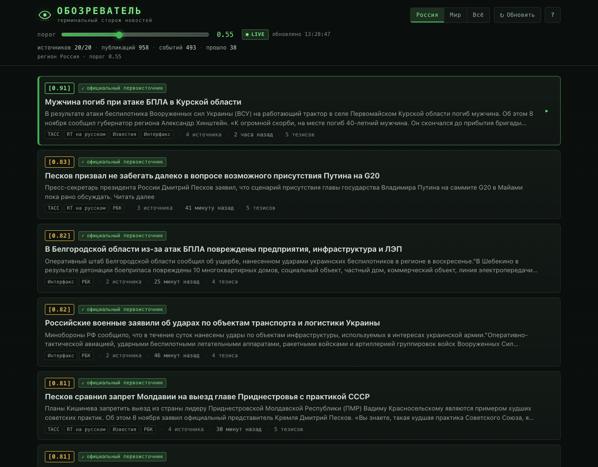
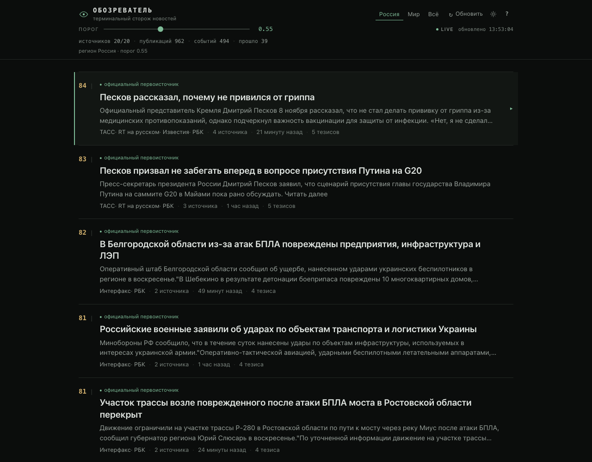
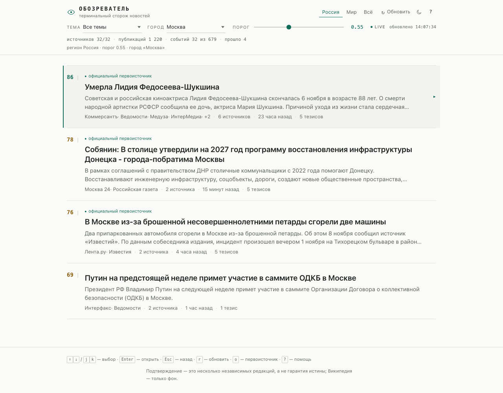
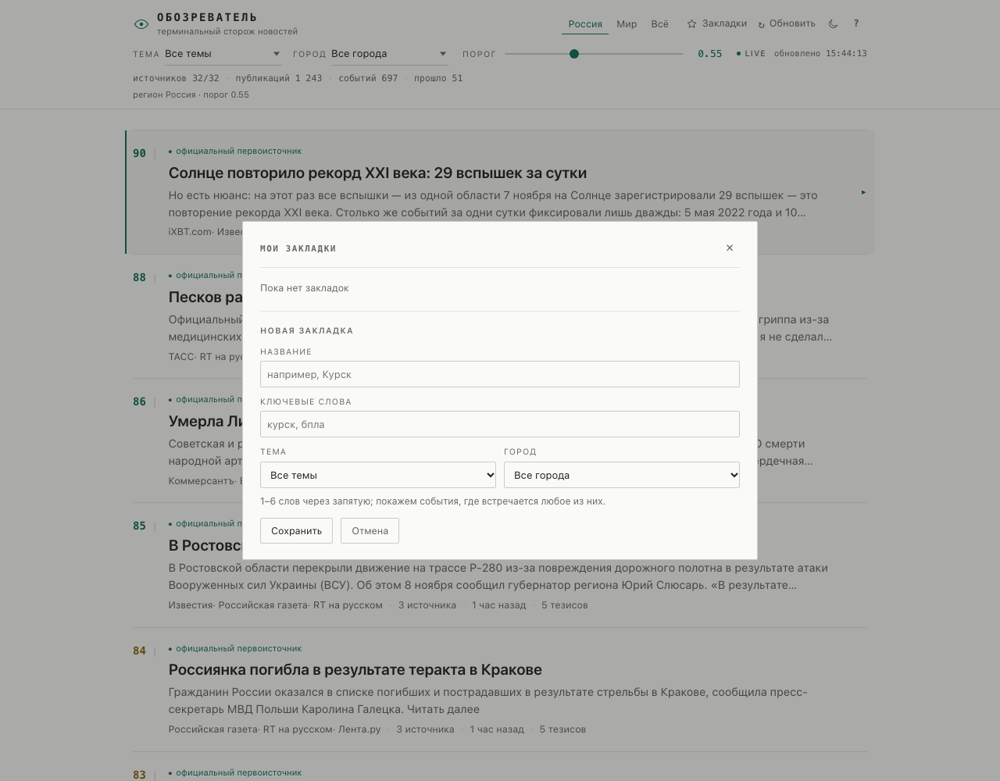
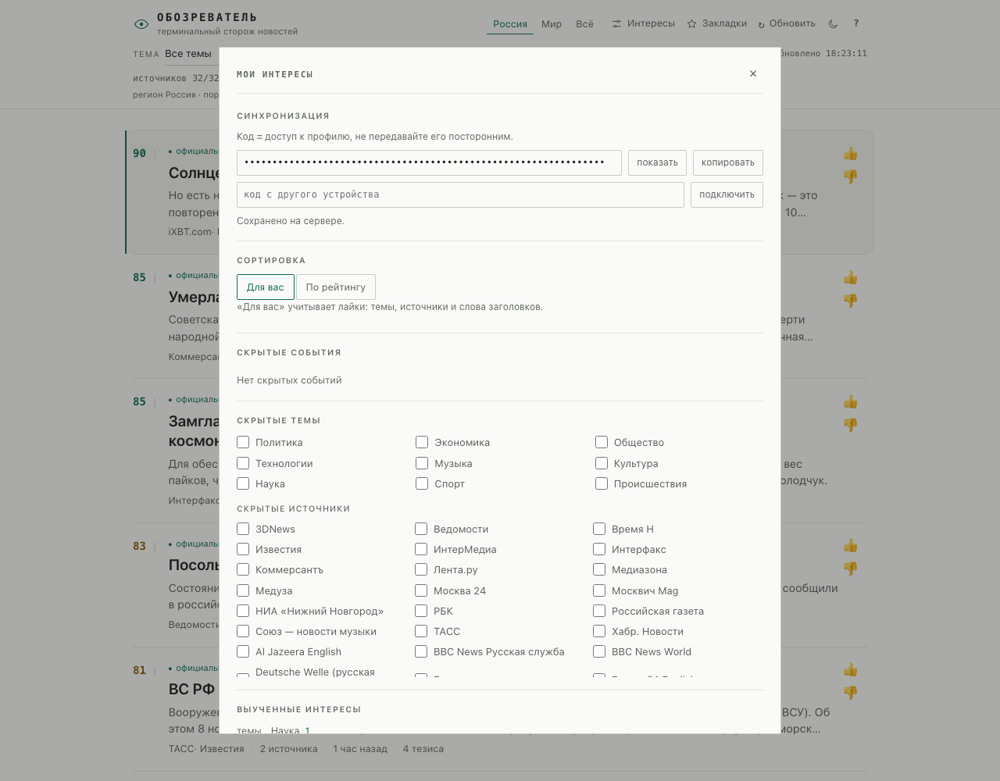
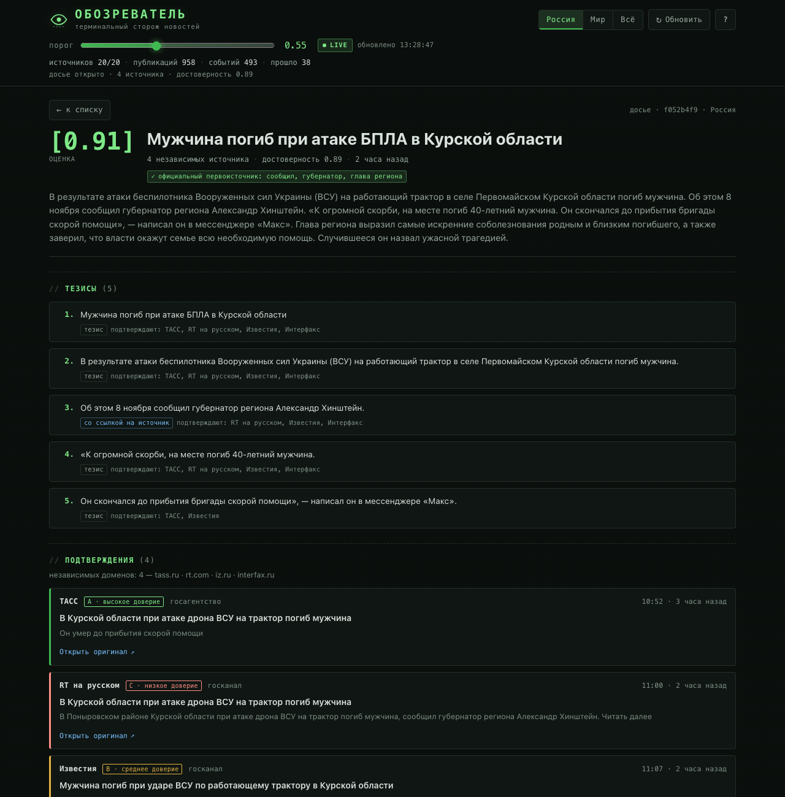
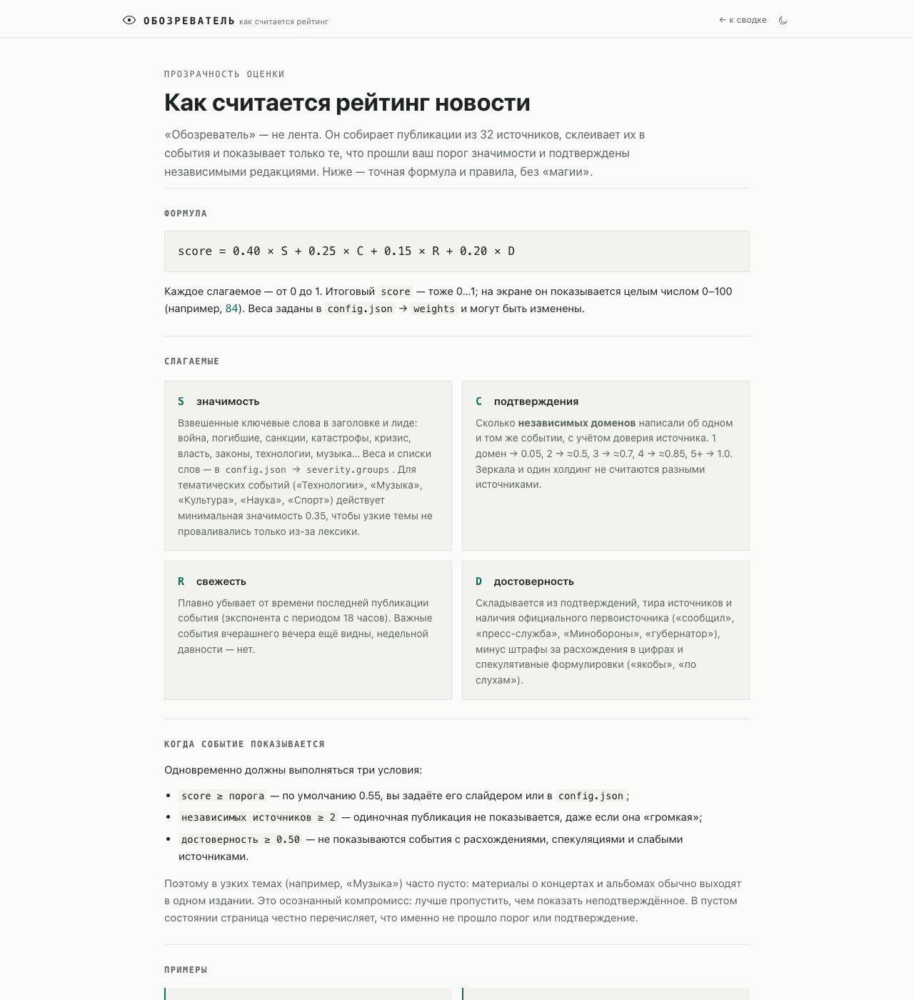

# Обозреватель

Терминальный сторож новостей: команда `oboz` собирает свежие публикации из независимых RSS-лент,
склеивает их в **события**, оценивает значимость и подтверждённость и показывает **только то, что
превысило ваш порог**. Если ничего существенного не произошло — так и говорит (или печатает пусто
с флагом `--quiet`).

Это не лента «5 новостей», а фильтр: одно событие с подтверждениями вместо двадцати заголовков.
Внутри события можно пройти стрелками по тезисам, источникам и ссылкам — вплоть до первоисточника
и фоновой статьи Википедии.

```
ОБОЗРЕВАТЕЛЬ · РОССИЯ · 08.11.2026 12:06 · порог 0.55
Источники: 32/32 · публикаций: 1 220 · событий: 679 · прошло фильтр: 52

1. [0.87] Мужчина погиб при атаке БПЛА в Курской области
    Мужчина погиб после атаки украинского дрона в Поныровском районе Курской области, сообщил
    губернатор Александр Хинштейн...
    ТАСС, RT на русском, Интерфакс — 3 источника · 55 мин назад · 4 тезиса
    ▸ oboz item 4799a209
```

---

## Быстрый старт

Нужен только **Node.js ≥ 20** (проверено на Node 25.8). Внешних зависимостей и установки нет.

```bash
git clone https://github.com/martiyanov/oboz.git
cd oboz

./oboz news --region ru        # сводка по России (первый запуск ~10 сек, дальше из кэша)
./oboz tui                     # интерактивный разбор: стрелки, Enter, Esc
./oboz news --region world     # мировая повестка
./oboz news --category tech    # только технологии (music, culture, science, sport, …)
./oboz news --city moscow      # только Москва (nizhny — Нижний Новгород)
./oboz news --query "Курск, БПЛА"   # по ключевым словам (как закладка)
./oboz news --explain          # что не прошло фильтр и почему
```

Устанавливать ничего не нужно: зависимостей нет, `oboz` — исполняемый файл.

Если ничего не произошло:

```bash
./oboz news --threshold 0.95            # — Ничего существенного не произошло. ...
./oboz news --threshold 0.95 --quiet    # пустой вывод (0 байт) — удобно для скриптов
```

Проверить без сети, на демонстрационном наборе:

```bash
./oboz news --demo
./oboz tui --demo
```

Пример реального вывода со всеми режимами — [`docs/DEMO.md`](docs/DEMO.md).

## Веб-версия

Та же логика, что в терминале, но в браузере: **https://agonarena.ru/oboz/**

Список значимых событий, досье с тезисами, подтверждениями, расхождениями и Википедией,
клавиатурная навигация (↑↓/Enter/Esc), автообновление раз в минуту, слайдер порога, регион,
фильтры по теме (Технологии, Музыка, Культура, Наука, Спорт, …) и городу (Москва, Нижний Новгород).
Сервер — тот же `src/digest.js`, поэтому оценки и фильтр совпадают с CLI/TUI.

Две темы — светлая и тёмная, кнопка переключения в шапке; выбор запоминается, а без него
интерфейс следует системной теме.

| Светлая | Тёмная |
|---|---|
|  |  |

Фильтры по теме и городу (Москва, Нижний Новгород) — минималистичные селекторы в шапке:



Важно: фильтры **не ослабляют правило подтверждений** — событие всё равно должно быть выше
порога и подтверждено независимыми источниками. В узких темах (например, музыка) поэтому может
быть пусто: одиночные публикации не показываются, а в пустом состоянии перечислены события,
которые не прошли порог/подтверждение, — чтобы было видно, что происходит.

### Закладки и уведомления

Кнопка «☆ Закладки» в шапке — личные подписки: сохраните текущую новость (кнопка
«☆ в закладки» в досье) или введите ключевые слова вручную. Закладка запоминает 1–6 слов,
тему и город; лента фильтруется по ней (те же `q`, `category`, `city` в URL — ссылкой можно
поделиться). Новые совпадения показываются бейджем на кнопке, а если разрешить уведомления —
приходит браузерное уведомление (пока вкладка открыта, даже в фоне).



Закладки хранятся **локально в вашем браузере** (`localStorage`), на сервере не создаётся
профиля. Для терминала те же слова доступны как `./oboz news --query "Курск, БПЛА"`.
Ограничение: это не push через Service Worker — при полностью закрытой вкладке уведомлений
не будет; для фоновых push нужен отдельный шлюз (Telegram/почта), это в бэклоге.

### Персонализация

👍/👎 на карточке и в досье: 👍 поднимает похожие темы/источники/слова в сортировке «Для вас»,
👎 **сразу скрывает** новость (с тостом и кнопкой «Вернуть»). В «Мои интересы» можно скрывать
целые темы и источники (переключатели), смотреть выученные веса, переключать «Для вас / По
рейтингу» и сбросить профиль.



Профиль **анонимный и синхронизируется между устройствами**: браузер генерирует случайный код
(64 hex), сервер хранит профиль в `.state/profiles/<sha256(кода)>.json` без аккаунтов и
персональных данных. На другом устройстве введите код в «Моих интересах» — профили объединятся.
Код — это пароль к профилю: не публикуйте его. Скрытие источников влияет только на вашу ленту,
объективный score и правило подтверждений не меняются.



Локальный запуск (без ВДС):

```bash
npm run web            # http://127.0.0.1:8788
OBOZ_WEB_DEMO=1 npm run web   # демо-данные без сети
```

Устройство, деплой, эксплуатация и диагностика — в [`docs/WEB.md`](docs/WEB.md),
контракт API — в [`docs/WEB_API.md`](docs/WEB_API.md).

### Как считается рейтинг и обратная связь

Отдельная страница **https://agonarena.ru/oboz/rating** объясняет формулу оценки: значимость,
подтверждения, свежесть, достоверность, правило «≥ 2 независимых источника», примеры и что
формула не гарантирует. Там же — ссылка на репозиторий с терминальной утилитой и защищённая
форма обратной связи по качеству рейтинга.



Сообщения сохраняются на сервере в `.state/feedback.jsonl` и читаются командой
`./oboz feedback`. Защита формы: скрытое поле-ловушка, проверка времени заполнения, проверка
Origin, лимиты 3/час и 10/сутки на IP (плюс глобальный дневной лимит), ограничение размера,
IP хранится только как необратимый хеш. Публичного доступа к сообщениям нет.

---

## Команды

| Команда | Что делает |
|---|---|
| `oboz` / `oboz tui` | интерактивный разбор (стрелки, Enter, Esc) |
| `oboz news` | сводка в терминал |
| `oboz item <id>` | полное текстовое досье события по id из сводки |
| `oboz watch [--every 60m]` | периодический обзор: раз в час, только новые события |
| `oboz sources [--check]` | список источников / проверка доступности и свежести |
| `oboz feedback [--limit 20]` | прочитать обратную связь с веб-страницы рейтинга |
| `npm run web` | веб-версия на `http://127.0.0.1:8788` |
| `oboz config` | итоговая конфигурация с учётом дефолтов |
| `oboz help` | справка |

### Флаги

| Флаг | Значение |
|---|---|
| `--region ru\|world\|all` | регион повестки (по умолчанию `ru`) |
| `--threshold 0.55` | порог значимости `0..1` |
| `--limit 12` | сколько событий показать |
| `--json` | машинный вывод (`news`) |
| `--explain` | показать отклонённые события с причинами |
| `--quiet` | пустой вывод, если ничего не произошло |
| `--demo` | демонстрационные данные без сети |
| `--no-cache` | заново скачать ленты |
| `--wiki` | подгрузить справку Википедии прямо в `news` (в TUI грузится при открытии) |
| `--every 30s\|15m\|1h` | период для `watch` |
| `--once` | один цикл `watch` и выход |
| `--width 96` | ширина обычного вывода |

### Управление в TUI

| Клавиша | Действие |
|---|---|
| `↑` `↓` / `j` `k` | выбор строки |
| `Enter` | открыть: событие → тезис → источник → Википедия |
| `o` | открыть ссылку в браузере |
| `Esc` / `←` | назад |
| `t` / `T` | повысить / понизить порог на 0.05 (без повторной загрузки) |
| `g` | сменить регион: Россия → Мир → Всё |
| `e` | показать события, не прошедшие фильтр (для настройки порога) |
| `r` | заново загрузить ленты и пересчитать |
| `?` | помощь |
| `q` | выход |

Цепочка разбора: **список событий → досье (тезисы + подтверждения + проверка) → тезис → карточка
публикации → браузер**. Ссылка открывается в системном браузере (`open` на macOS).

---

## Как решается, показывать новость или нет

Пайплайн: `RSS → нормализация → кластеризация → доказательства → оценка → порог → вывод`.

### 1. Сбор и склейка

32 включённые ленты (20 российских + 12 зарубежных, включая тематические и городские), каждая
публикация приводится к единому виду. Заголовки сравниваются по значимым словам с грубым русским стеммингом; публикации
об одном событии из разных редакций склеиваются в кластер. Склейка сравнивает публикацию с
«представителем» кластера (а не с любым его членом) и требует редких общих слов/биграмм — это
защищает от цепочки ложных склеек, когда «A похоже на B, B похоже на C, но A и C — разные события».

### 1.1. Темы и города

Каждая публикация размечается по специализированным лентам и ключевым словам в заголовке/лиде
(см. `topics.json`): «Технологии», «Музыка», «Культура», «Наука», «Спорт», «Происшествия» и др.
Город определяется по локальной ленте (`city` в `sources.json`) или упоминанию («в Москве»,
«в Нижнем Новгороде»). Фильтры `--category`/`--city` (и селекторы в вебе) применяются к уже
оценённым событиям, поэтому порог и правило подтверждений продолжают работать.

### 2. Оценка события

```
score = 0.40 × значимость + 0.25 × подтверждения + 0.15 × свежесть + 0.20 × достоверность
```

* **значимость** — взвешенные ключевые слова в заголовке и лиде: война/БПЛА/погибшие/санкции/
  катастрофы/кризис/власть/законы... Веса задаются в `config.json` → `severity.groups`; легко
  переписать под свои интересы.
* **подтверждения** — число **независимых доменов** в кластере с учётом доверия источника:
  `1 → 0.05`, `2 → ~0.5`, `3 → ~0.7`, `4 → ~0.85`, `5+ → 1.0`. Дубли одной редакции
  (`lenta.ru` / `m.lenta.ru`, `rbc.ru` / `rssexport.rbc.ru`) считаются одним источником.
* **свежесть** — экспоненциальное затухание от времени последней публикации.
* **достоверность** — подтверждения + ссылка на официальный первоисточник + отсутствие
  расхождений в цифрах + отсутствие спекулятивных формулировок («якобы», «по слухам») − штрафы.

### 3. Порог и жёсткие условия

Событие показывается, только если выполнены **все** условия:

1. `score ≥ threshold` (по умолчанию `0.55`);
2. `независимых источников ≥ minDomains` (по умолчанию `2`);
3. `достоверность ≥ minConfidence` (по умолчанию `0.50`).

Поэтому новость **одного** источника не покажется, даже если она «громкая». Это осознанный
компромисс: лучше пропустить, чем показать неподтверждённое.

Настройка в `config.json`:

```json
{
  "threshold": 0.55,
  "minDomains": 2,
  "minConfidence": 0.5,
  "maxAgeHours": 36,
  "weights": { "severity": 0.4, "corroboration": 0.25, "recency": 0.15, "confidence": 0.2 }
}
```

Хотите только крупное — `--threshold 0.75`. Хотите видеть больше — `--threshold 0.45`, но
готовьтесь к шуму. Посмотреть, что именно отсекается, — `--explain` или клавиша `e` в TUI.

---

## «Не хочу фейковую новость» — что здесь есть и чего нет

**Что делает инструмент:**

* **не показывает событие без второго независимого источника**;
* считает источниками **разные домены**, а не разные перепечатки;
* размечает **тир доверия**: A — агентства первого ряда и качественные издания, B — крупные
  медиа, C — госканалы/агрегаторы (ТАСС и Интерфакс — A, RT и «Российская газета» — C);
* ищет **официальный первоисточник**: «сообщил», «пресс-служба», «Минобороны», «губернатор»,
  «по данным» — и показывает, что именно найдено;
* показывает **расхождения в цифрах** между источниками (например, разное число погибших);
* помечает **спекулятивные формулировки**;
* даёт прямые ссылки на все публикации и **фоновую справку Википедии** (только как контекст).

**Чего инструмент не делает (честно):**

* это **не редакционный фактчекинг** — он не звонит в пресс-службу и не проверяет документы;
* совпадающее сообщение нескольких изданий **не гарантирует истины** — они могут ссылаться на
  один и тот же анонимный источник; тир C и официальные маркеры как раз помогают это заметить;
* кластеризация эвристическая: иногда событие распадается на два (недосчёт подтверждений —
  безопасная ошибка) или, реже, склеивается лишнее (это видно по списку публикаций);
* географический фильтр «Россия/мир» — эвристика по упоминаниям, а не строгая геолокация;
* Википедия — фон, а не доказательство.

Главный принцип: **инструмент не придумывает текст и не пересказывает его моделью.** Все тезисы —
цитаты/фрагменты реальных публикаций, все ссылки ведут на оригиналы. Поэтому «галлюцинаций» здесь
нет по конструкции: проверить можно каждый пункт.

---

## Источники

Каталог — `sources.json`, отчёт о проверке доступности и свежести — `docs/sources-report.md`.

32 включённые ленты. Общие: ТАСС, Интерфакс, «Коммерсантъ», РБК, «Ведомости», «Лента.ру»,
«Известия», RT, «Российская газета», «Медуза», «Медиазона»; BBC Russian, BBC World,
The Guardian, Al Jazeera, Deutsche Welle, France 24, Euronews, The New York Times, RFI.
Тематические: 3DNews, iXBT, «Хабр», TechCrunch (технологии); InterMedia, Soyuz, Pitchfork, NME
(музыка). Городские: «Москвич Mag», «Москва 24»; «Время Н», НИАНН (Нижний Новгород).

Часть сайтов закрыта DDoS-Guard и отдаёт 403 незнакомым клиентам, поэтому в `src/rss.js`
используется браузерный User-Agent. Если лента всё равно не читается — `./oboz sources --check`
покажет ошибку, а источник можно выключить в `sources.json` (`"enabled": false`).

Добавить/убрать ленту просто — отредактируйте `sources.json` (схема в `docs/CONTRACTS.md`).
После правок: `./oboz sources --check` и `./oboz news --no-cache`.

---

## Обзор раз в час

```bash
./oboz watch --every 60m
```

Первый цикл показывает текущую сводку, дальше — только **новые** события выше порога; состояние
хранится в `.state/seen.json`, журнал — в `.state/digest.log`. Пустые циклы печатают строку
«Ничего существенного…», с `--quiet` — молчат. На macOS есть системные уведомления.

Автозапуск через launchd (раз в час, лог в `.state/watch.log`):

```bash
bash scripts/install-launchd.sh          # установить агент ru.oboz.watch
launchctl list | grep oboz               # проверить
tail -f .state/watch.log                 # смотреть, что приходит
bash scripts/install-launchd.sh --uninstall
```

Скрипт только генерирует plist в `~/Library/LaunchAgents` — запускайте его сами, когда захотите.

---

## JSON и скрипты

```bash
./oboz news --json | jq '.passed[] | {score, title, domains}'
./oboz news --json | jq '.stats'
```

В JSON: `generatedAt`, `region`, `threshold`, `empty`, `stats`, `passed[]`, `rejected[]`.
Каждое событие содержит `claims`, `conflicts`, `attribution`, `articles` (с `link`), `wiki`.

Коды возврата: `0` — успех (даже если событий нет), `1` — событие по id не найдено, `2` — ошибка
аргументов. Пустой вывод при `--quiet` — ровно 0 байт.

---

## Структура

```
oboz                     исполняемый файл CLI
config.json              порог, веса, ключевые слова, маркеры
sources.json             каталог RSS-лент (регион, тир, тип, темы, город)
topics.json              категории, города и ключевые слова для разметки
src/
  cli.js                 команды и флаги
  digest.js              сборка сводки: загрузка → кластеры → оценка → порог
  rss.js                 загрузка и разбор RSS с дисковым кэшем (.cache/rss)
  cluster.js             склейка публикаций в события
  score.js               значимость/подтверждения/свежесть/достоверность, gate
  evidence.js            тезисы, расхождения, первоисточник, Википедия
  tui.js                 интерактивный терминальный интерфейс
  watch.js               периодический обзор
  format.js              текстовые форматы (сводка, досье, таблица источников)
  demo.js                демонстрационный набор без сети
  topics.js              разметка тем/городов и фильтрация событий
  util.js, paths.js      утилиты и пути
web/
  server.mjs             HTTP-сервер веб-версии (API + статика, без зависимостей)
  public/                index.html, app.js, style.css, favicon.svg
deploy/                  systemd-юнит и nginx-snippet для ВДС
scripts/                 launchd-установщик, деплой веба, headless-проверка TUI
test/                    автотесты (node:test)
docs/CONTRACTS.md        контракты модулей
docs/sources-report.md   отчёт по источникам
```

Кэш и состояние: `.cache/` (ленты 30 мин, Википедия 24 ч), `.state/` (seen, журнал). Оба каталога
в `.gitignore`.

---

## Тесты

```bash
npm test                      # node --test (офлайн; сетевой wiki-тест пропущен)
node scripts/tui-headless.mjs # прогон TUI без терминала: кадры экранов
OBOZ_WEB_DEMO=1 npm run web   # веб-версия на демо-данных без сети
./oboz news --demo --threshold 0.95   # проверка пустого состояния
```

---

## Ограничения MVP и что дальше

Уже работает: сбор 32 лент, кластеры, оценка, порог, пустой результат, досье с подтверждениями,
Википедия, TUI, часовой обзор, launchd, JSON, демо-режим.

Дальше по смыслу:

1. **Ключи API** — NewsAPI/GNews/Mediastack как дополнительные адаптеры (`sources.json` уже
   описывает источник; нужен только тип `api`). MVP намеренно работает без ключей: RSS бесплатен
   и не требует регистрации.
2. **Веб-версия** — уже есть: `https://agonarena.ru/oboz/` (см. [`docs/WEB.md`](docs/WEB.md)).
   Дальше: поддомен `oboz.agonarena.ru`, кэширование через CDN, персональные настройки.
3. **Сильнее проверка фактов** — портал «Текущие события» Википедии, Wikidata, пресс-релизы
   ведомств, сверка дат/чисел, детект «все ссылаются на один анонимный источник».
4. **Персонализация** — уже есть темы/города; дальше — сохранённые профили интересов и подписки.
5. **Уведомления** — Telegram-бот или почта с часовым дайджестом.
6. **История** — «что изменилось с прошлого часа», тренды, повторяемость событий.
7. **Лучшая кластеризация** — эмбеддинги заголовков вместо лексических правил.
8. **LLM-сводка с цитатами** — строго с привязкой каждого предложения к ссылке-источнику.

---

## Ресурсы

Сколько сервис занимает на ВДС и как уменьшить расходы — [`docs/RESOURCES.md`](docs/RESOURCES.md):
замеры памяти/CPU/диска/сети, оценка трафика лент (~5.5–6 ГБ/мес при текущем `cacheTtlSec=1800`),
таблица вариантов TTL и рекомендации. В `/healthz` добавлен блок `resources` (RSS, heap, кэши,
сохранённые отзывы).

## Бэклог

Идеи, которые сознательно не входят в MVP, — в [`docs/BACKLOG.md`](docs/BACKLOG.md).
Ближайшая крупная: **OBS-001 — графическая и количественная картина события** (часовые срезы
источников, sparkline, накопленная кривая, гистограмма, сравнение с базовым распределением и
объяснимый балл «аномальности распространения»), чтобы отличать естественную волну от ровной
синхронной кампании. Там же — модель данных, статистика (Gamma/lognormal, энтропия источников,
текстовая близость, синхронность), риски ложных срабатываний и ссылки (в т.ч. на рассуждения
Игоря Ашманова о «вбросах» и характере распространения).

---

## Частые проблемы

* **`node: command not found` / старая версия** — нужен Node ≥ 20.
* **Первый запуск медленный** — 32 ленты скачиваются параллельно (~8–15 сек) и кэшируются на 30 мин.
* **Источник «ошибка»** — `./oboz sources --check`; часть сайтов отдаёт 403 без браузерного
  User-Agent (так был отключён `iz.ru`).
* **Нет сети** — приложение использует последний удачный кэш лент и не падает; свежесть события
  будет хуже, в `stats.sourcesStale` это видно.
* **TUI в piped-режиме** — если вывод не в терминал, печатается обычная сводка.
* **Браузер не открылся** — `o` работает через `open` (macOS), `xdg-open` (Linux), `start`
  (Windows); в headless-окружении просто покажет сообщение.

---

## Приватность

Никакой телеметрии, аккаунтов и API-ключей. Приложение ходит только в RSS-ленты из `sources.json`
и в `ru.wikipedia.org`. Кэш и состояние лежат локально в проекте.
